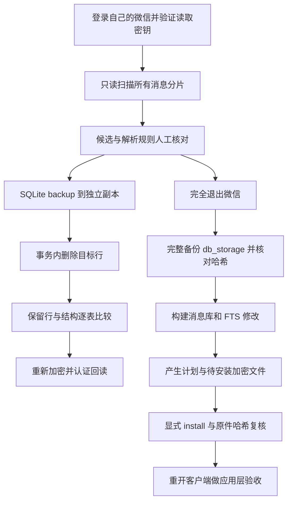

# 微信消息删除项目：数据库、页加密、FTS 与离线写回

本文面向希望理解源码和复现实验的开发者。先解释“删除”究竟发生在哪一层，再沿实际代码分析数据库定位、正文解析、SQL 事务、加密页面、搜索索引和文件安装。文中所有账号、目录和联系人均为虚构示例；没有发布私人数据库、密钥或聊天原文。

**阅读基线：**本仓库公开副本、Python 3.11+、Windows 微信 4.x 的特定已观察样本、`wechatauto-replica==1.2.1`。原生发送的 4.2.0.11 指纹不等于删除流程已经覆盖所有 4.x 数据格式。微信没有为本项目提供稳定的数据库修改 SDK，任何布局结论都要结合所读源码和运行时校验理解。

## 目录

1. [能力范围与证据层次](#1-能力范围与证据层次)
2. [源码入口和总体数据流](#2-源码入口和总体数据流)
3. [微信本地数据库为什么不是一个文件](#3-微信本地数据库为什么不是一个文件)
4. [读取层如何取得可查询数据](#4-读取层如何取得可查询数据)
5. [WAL、快照与离线条件](#5-wal快照与离线条件)
6. [消息身份和正文匹配](#6-消息身份和正文匹配)
7. [只读扫描的真实行为](#7-只读扫描的真实行为)
8. [副本上的 SQL 删除与差异证明](#8-副本上的-sql-删除与差异证明)
9. [加密页的逐字节布局](#9-加密页的逐字节布局)
10. [重新加密与认证回读](#10-重新加密与认证回读)
11. [为什么必须处理全文搜索索引](#11-为什么必须处理全文搜索索引)
12. [原词元重放与 FTS5 删除](#12-原词元重放与-fts5-删除)
13. [会话摘要、未读和媒体引用](#13-会话摘要未读和媒体引用)
14. [备份、计划与构建](#14-备份计划与构建)
15. [安装、回滚与恢复](#15-安装回滚与恢复)
16. [复现步骤与返回结果](#16-复现步骤与返回结果)
17. [测试证据与未覆盖风险](#17-测试证据与未覆盖风险)
18. [如何向新版本扩展](#18-如何向新版本扩展)
19. [隐私与源码阅读顺序](#19-隐私与源码阅读顺序)
20. [参考资料](#20-参考资料)

## 1. 能力范围与证据层次

这里的删除是：从本机一个已选微信账号的历史消息数据库里移除特定记录，同时维护本次样本涉及的本地搜索索引。它不会向网络发送撤回协议，也不会让其他群成员或联系人的设备同步删除。数据库里的 `server_id` 用于识别记录，并不赋予修改服务器历史的能力。

项目经历的技术层次需要分开理解：

| 层次 | 实际执行内容 | 能证明什么 | 不能证明什么 |
| --- | --- | --- | --- |
| 只读可行性扫描 | 解密缓存查询、正文解析、候选记录导出 | 可以找到本机可读历史中的匹配消息 | 原始消息已经删除 |
| 独立副本实验 | 对 SQLite 备份副本执行 DELETE，再重加密、回读 | 目标行可删除，保留数据及加密往返能受检查 | 原加密文件已改变、客户端会接受 |
| 受限离线写回 | 备份、构建消息库及 FTS 修改、安装指定文件 | 指定本地加密文件可以在校验约束下被替换 | 任意关键词/任意规模都适用、客户端体验完整正常 |
| 客户端验收 | 重开微信，查看目标会话、搜索、未读及后续收发 | 对具体账号、版本、样本的应用层兼容性证据 | 对所有版本和所有消息类型的普遍保证 |

因此，“是删除整个数据库，还是解密后执行 SQL 再加密”可以精确回答：**逻辑删除发生在解密后的 SQLite 副本中；最终按完整文件替换选定加密数据库，但文件里的非目标记录被要求保留。**替换文件是部署修改结果的方式，不等于删掉这个文件里的全部聊天。

公开源码还保留了原写回实验的样本约束：`cy`、两条消息、`message_0.db` 加 `message_fts.db`。扫描器和副本实验支持指定关键词，写回器没有因此自动变成通用关键词清理工具。代码里遇到其他关联情况时拒绝继续，是可见的能力边界。

## 2. 源码入口和总体数据流

核心文件均在 `wechat_message_cleanup/`：

| 文件 / 函数 | 关注的问题 |
| --- | --- |
| `test_delete_cy.py: run` | 读取器是否有真正删除接口？能找到哪些匹配？ |
| `message_parser.py: clean_group_content` | 一行消息如何转换为用于匹配的正文？ |
| `contacts.py: load_contact_names` | 会话用户名与显示名如何映射？ |
| `test_offline_delete_cy.py: main` | 如何只修改独立副本，并验证其他行没变？ |
| 同文件 `encrypt_snapshot` / `authenticated_decrypt` | 如何构造和验证加密页？ |
| `prepare_offline_writeback.py: main` | 如何得到经过哈希核对的停机备份？ |
| `offline_writeback.py: open_fts` / `build` | 如何更新自定义分词的全文索引？ |
| 同文件 `install` / `checked_source` / `checked_run` | 如何安装、拒绝覆盖新数据并限制路径？ |



图中的副本实验与写回构建是两个入口。运行副本实验不会自动调用安装，也不会把 `after.encrypted.db` 复制回微信目录。安装必须使用写回流程生成且通过条件检查的 `plan.json` 与 staged 文件。

## 3. 微信本地数据库为什么不是一个文件

这里观察的数据目录可以概括为：

```text
xwechat_files/
  example_account/
    db_storage/
      contact/contact.db
      session/session.db
      message/message_0.db
      message/message_1.db        # 实际账号可能有更多分片
      message/message_fts.db
      message/message_resource.db
      ...
```

这只是本次实现使用的相对路径，不是承诺所有客户端都有完全相同的目录与表。代码枚举读取器报告的消息分片，不能只检查 `message_0.db` 就声称扫描了整个账号。

消息表按会话隔离，表名模式为 `Msg_` 加会话用户名 UTF-8 字节的 MD5 十六进制值。比如会话标识为虚构的 `example@chatroom` 时：

```python
table = 'Msg_' + hashlib.md5(conversation.encode('utf-8')).hexdigest()
```

这里 MD5 用于表名映射，不是加密，也不是权限凭据。只知道一个散列并不能反推联系人或获得数据库读取能力。脚本先从联系人数据取得已知用户名，再计算表名建立映射。若写回阶段某表无法映射到已核对会话，构建直接失败，不拿未知表名猜会话。

消息行中涉及的字段包括：

| 字段 | 本项目中的用途 | 容易出现的误解 |
| --- | --- | --- |
| `local_id` | 一张消息表中的本地行标识 | 它不是跨分片、跨群全局唯一 ID |
| `sort_seq` | 辅助排序及精确识别目标 | 不能只靠正文或时间代替身份 |
| `create_time` | 时间与跨库关联核对 | 同一秒可能有多条消息 |
| `server_id` | 网络确认后相关的服务端标识 | 不代表可从服务器删除 |
| `local_type` | 消息类型与子类型编码 | 不总能直接按一个小整数解释 |
| `message_content` / `compress_content` | 正文、XML 或压缩载荷 | 不保证是直接可搜索的 UTF-8 文本 |

生产写回使用分片、表名、`local_id`、`sort_seq` 等联合识别。搜索索引还要使用会话内部 ID 和创建时间。跨库的 `rowid` 与消息行的 `local_id` 不是同一个命名空间。

## 4. 读取层如何取得可查询数据

本项目没有重新实现全部微信密钥发现。它复用 `wechatauto-replica` 的 `WeChatDB`，并局部覆盖进程枚举以使用 `psutil`。这样避免某些环境下 `tasklist` 失败后，库把“无法枚举进程”误报为“用户没有登录”。没有修改全局安装包，也没有通过 GUI 点击取得历史。

读取库 1.2.1 的工作可拆成四层：

1. 定位本机数据根目录和显式账号目录。
2. 枚举数据库，加载或发现每个库可用的加密密钥。
3. 把加密主库及必要 WAL 内容解密到本机工作缓存。
4. 用 `sqlite3.connect(...?mode=ro, uri=True)` 打开缓存，供调用方查询。

**密钥发现不是暴力破解 AES。**已登录客户端需要使用这些数据库，相关密钥材料会以某种可用形式存在于它的当前进程或受本机保护的配置中。读取库使用本机进程读取能力搜索候选，再用实际数据库第一页认证信息验证候选是否正确。没有访问目标进程或缓存的能力，仅凭数据库文件不会自动得到密钥。

在所核对的上游源码中，加载流程优先使用显式传入的主密钥或已缓存的 `keys.json`；缺少密钥时尝试当前客户端的配置对象/内存发现，再走兼容回退。内存路径包含 `OpenProcess`、`ReadProcessMemory`、配置名称及相邻结构的识别，然后提取候选 key/salt。候选通过第一页 HMAC 校验后才绑定某个库。此结构本身也具有版本相关性。

本仓库不把上游源码注释中的“零误报”当作所有环境的安全保证。对本项目有意义的是具体检查：候选密钥是否通过被选数据库的认证，缓存是否仍对应当前文件，哪些分片仍无密钥，以及每个异常是否被记录并停止相关操作。

还有一个必须明确的隐私事实：上游会保存本机密钥缓存，明文数据库也写入工作缓存。删除项目的报告不直接输出密钥，不等于密钥从未落盘。离线阶段正是依赖退出微信前已验证的本机缓存；微信退出后如果没有密钥，就不应预期工具还能从一个已不存在的进程重新提取。

## 5. WAL、快照与离线条件

### 5.1 主文件不一定是最新数据库

SQLite 的 WAL 模式允许把更新先写入 `-wal`，稍后 checkpoint 再合并进主文件。因此复制一个 `.db` 却忽略其 WAL，可能得到较旧或不完整的逻辑状态。`-shm` 则与 WAL 读写协调有关，不是消息正文备份。相关机制可参见 [SQLite WAL 文档](https://www.sqlite.org/wal.html)。

读取库 `_open` 观察主库和 WAL 的修改时间、尺寸及已合并帧位置。主库变化、WAL 重置或缓存版本不匹配时重建明文缓存；普通追加时尝试增量解密合并。所核对实现的 WAL 头为 32 字节，每帧是 24 字节头加 4096 字节加密页；帧页号采用大端表示。

读取器还检查帧 salt 是否属于当前 WAL 代际。checkpoint 重置后的旧帧不能再次覆盖到新主库。页面则用它对应的逻辑页号解密，再覆盖缓存中的相应页位置。

### 5.2 不要把缓存合并算法当作完整数据库事务引擎

本项目委托上游处理加密 WAL，不能把它的所有细节简化为“SQLite 已为我们处理了一切”。源码是页合并加结构检查和有限重试，并不在此重新实现一套经过完整证明的 WAL 提交边界、校验和与跨文件一致性协议。尤其在微信仍写文件时，文件尺寸和时间戳可能再次变化。

副本实验的 `sqlite3.Connection.backup` 可以给已打开的逻辑 SQLite 缓存制作独立快照；它不能修复此前缓存生成时已有的不一致。`integrity_check` 和保留行核对提供额外证据，但仍不能证明跨多个库来自同一个业务事务时间点。

### 5.3 为什么写回必须停机

写回阶段反复枚举 `weixin.exe` 与 `wechat.exe`，发现进程存在就拒绝继续。原因不仅是文件被锁：运行中的微信还有内存缓存、待提交事务、WAL 写游标、会话状态和网络更新。外部改完文件，它可能立即把旧内存内容重新刷回去，或在新的页面基础上继续追加旧代际 WAL。

仅关闭窗口或最小化不能满足该条件。必须退出客户端，使相关进程消失。`require_stopped()` 在备份前后、构建前后、逐文件替换前和最终校验处再次执行，用于缩短停机假设失效后的继续操作范围。

这仍有检查与使用之间的时间窗口：检查刚完成后微信可能被用户启动。代码不是操作系统级的全局互斥协议，也没有阻止微信重启的守护机制。若发现重启，恢复可能被延后，不能在微信正在写时强行回滚。

## 6. 消息身份和正文匹配

### 6.1 匹配针对解析正文

`keyword in clean_group_content(row, names, user)` 是大小写敏感的 Python 子串判断。`cy` 不匹配 `CY`，也不是整词或正则查询。扫描不是对密文做字节查找，也不是直接执行 `WHERE message_content LIKE '%cy%'`。

解析器先处理消息类型，再尝试普通 UTF-8 或包含 Zstandard 魔数的压缩载荷。XML 卡片和系统消息可能被转换为摘要；群消息可能带发送者前缀。扫描的是这些规则最终产生的文本，所以“界面上看起来有关键词”和“本解析器输出命中”不是严格同义。

示例：

| 存储内容 | 解析后的可能形式 | 对关键词匹配的影响 |
| --- | --- | --- |
| 普通文字 | 正文 | 通常直接参与 |
| 压缩 XML | 解析成功后的标题或摘要 | 原始 XML 里其他字段未必可见 |
| 图片/语音/视频 | 类型标签或有限摘要 | 没有 OCR、转写或媒体内容搜索 |
| 引用卡片 | 取决于删除项目保留的旧解析规则 | 不能直接假设等同 Violet 的结构化引用解析 |
| 解码失败的二进制 | 空串或类型描述 | 可能不命中；候选人工审核很重要 |

Violet 后来增加了更完整的 type 57 引用解析；删除项目保留它自己经过验证的解析器，没有在发布时悄悄改变历史匹配语义。若要把新版解析器用于删除，应先比较候选差异，而不是直接替换函数后写原库。

### 6.2 不能用显示名代替身份

显示名只帮助人核对候选。联系人备注、群名可以重复或变化，真实会话仍由本地存储的用户名标识。写回表名通过会话用户名确定，目标行再由具体字段确定。相同正文、相同时间和相同昵称都不是足够的删除条件。

## 7. 只读扫描的真实行为

`test_delete_cy.py` 首先检查上游 `WeChatDB` 是否暴露公开的 delete/recall/revoke 类方法，并检查 `_open` 是否采用只读缓存。当前依赖下没有经过验证的原始消息删除 API，于是它只生成候选。

程序遍历全部 `_message_dbs()`，枚举符合 `Msg_[0-9a-fA-F]{32}` 的表，再逐行解析。它不会把某个群监听名单当作所有会话，也不会只扫描客户端当前选中的聊天。它的“全部”仍限于所选账号、本机存在、读取器发现且可成功解密的分片；缺少历史、未同步的消息、其他账号和其他设备均不在范围内。

报告中区分：扫描分片数、表数、行数、命中数、原始删除数、异常列表和扫描是否完整。候选 JSONL 包含账号、会话、分片、表、行标识和正文，因此是敏感输出。

返回码 `2` 表示扫描可完成但原始删除接口不可用。它不是“SQL 删除成功”的信号。出现部分分片失败时也不能只看命中数量就推断不存在其他匹配消息，应检查 `scan_complete` 和 `errors`。

## 8. 副本上的 SQL 删除与差异证明

### 8.1 为什么使用 backup 而不只 copy 明文文件

副本实验打开读取缓存的 SQLite 连接，调用 `source.backup(destination)` 得到 `before.db`。这是从 SQLite 的连接视角复制数据库；直接拷一个可能仍有活动连接的明文文件，语义更难保证。之后 `shutil.copy2` 把独立的 before 复制为 after，所有写操作只作用于 after。

### 8.2 事务中的实际删除

副本实验进入事务，使用经过严格表名模式检查的表名和参数化行 ID：

```sql
BEGIN IMMEDIATE;
DELETE FROM "Msg_<verified-md5>" WHERE local_id = ?;
```

写回构建的身份条件更严格：

```sql
DELETE FROM "Msg_<verified-md5>"
WHERE local_id = ? AND sort_seq = ?;
```

每次删除要求 `rowcount == 1`。0 行说明目标不存在或前提失效；多行说明身份条件不够唯一，均拒绝继续。表名不能作为 SQL 参数，因此先限制命名模式；行值用参数绑定，避免把正文拼成 SQL。

写回构建设置 `journal_mode=DELETE` 与 `secure_delete=ON`。前者避免 staged 明文文件依赖未携带的 WAL；后者要求 SQLite 在适用时清除被删除内容的存储空间。但它不是对所有副本、备份、FTS 旧页、SSD 或操作系统缓存的取证擦除承诺。

### 8.3 比“条数少了两条”更强的核对

`inventories()` 对每张表构造 `Counter(encoded_row(row))`。行序列化区分 BLOB 与文本，BLOB 转为十六进制，其他值保留类型可表达的 JSON 表示。使用多重集而不是集合，可以保留完全相同记录的重复次数。

删除前记录 `before`，根据每个精确目标从对应 Counter 中减去一次，得到 `expected`。删除后要求全部表的实际库存等于 expected。这样可以发现“目标删了但其他消息也被误删”“辅助表无意变化”等问题，而不只比较总条数。

副本实验还比较 `sqlite_master` 中的类型、名称、所属表及 SQL 定义，检查 schema 没有变化；执行 `integrity_check` 与 `foreign_key_check`；再次解析正文确认副本中没有剩余匹配。SQLite 的这些检查分别面向结构与已声明外键，不会自动覆盖微信所有业务关联。它们的作用是分层验证，不能被一个 `ok` 代替全部兼容性判断。

## 9. 加密页的逐字节布局

以下是本项目及所核对读取库使用的特定布局，不是对任意微信版本的承诺。SQLCipher 的公开设计介绍了按页加密、随机 IV 和页认证的背景；这里的实际参数来自代码与本机文件格式验证。[SQLCipher 设计说明](https://www.zetetic.net/sqlcipher/design/)

页长 `P=4096`，保留区 `R=80`。保留区包含 16 字节 IV 和 64 字节 HMAC。标准形式中第一页前 16 字节放盐，解密缓存则恢复 SQLite 魔数：

```text
第 1 页（4096 字节）
  [   0,  16)  原文件头 / salt（特殊 key+salt 模式可能是明文头）
  [  16,4016)  加密有效负载，4000 字节
  [4016,4032)  IV，16 字节
  [4032,4096)  HMAC-SHA512，64 字节

第 n 页，n > 1
  [   0,4016)  加密有效负载，4016 字节
  [4016,4032)  IV
  [4032,4096)  HMAC-SHA512
```

4000 和 4016 都是 AES 的 16 字节块长度的整数倍，因此这里按有效区直接做 CBC，不额外套用 PKCS#7 填充。页号从 1 开始，不能把文件字节偏移直接当作认证页号。

代码处理两类 key 表示：

- 32 字节：数据库原始 AES key，认证派生的 salt 默认取原文件前 16 字节。
- 48 字节：前 32 字节 key，加显式的 16 字节 salt。该模式下第一页的明文头处理必须与上游一致，不能再把任意头字节当成 salt。

它们都不是把微信登录密码原样传给 AES。若已经取得可用的原始 key，就不能再次套用“口令到 AES key”的完整 PBKDF2 流程，否则得到另一把错误的 key。

认证派生与每页 MAC 在本代码中写成：

```text
mac_salt = salt 每个字节 XOR 0x3A
mac_key  = PBKDF2-HMAC-SHA512(aes_key, mac_salt, iterations=2, dkLen=32)
tag_n    = HMAC-SHA512(mac_key, ciphertext_n || IV_n || LE32(n))
```

这里的迭代 2 是已有原始 key 的 MAC 子密钥派生参数，不是建议用两次迭代保护用户口令。页号使用小端 32 位表示，而 WAL 帧头页号使用大端；这是两个不同位置，混淆后会认证失败。

## 10. 重新加密与认证回读

`encrypt_snapshot()` 首先检查明文总长是否为完整页数、页头记录的页大小是否等于 4096，以及保留区字节是否为 80。若 SQLite 构建、数据库格式或样本不满足这些条件，就不生成“看似成功”的加密文件。

每页生成新的 `os.urandom(16)` IV，AES-CBC 加密有效负载，再按上一节公式计算 MAC。第一页保留原始头部/盐值，避免在未重新派生所有密钥关系时擅自替换数据库身份参数。新 IV 意味着即使一页明文没变，其加密字节与旧文件也可能不同。因此不能以“加密文件哈希变了”判断哪些消息逻辑改变，逻辑核对要在解密层完成。

`authenticated_decrypt()` 对**每一页**重新计算 MAC，用 `hmac.compare_digest` 比较；通过后才调用上游页解密函数。明文缓存的 80 字节加密保留区被填零，不能将这些缓存字节误当作真实 MAC。

验证链包含：

1. 生成加密文件的第一页通过原读取器 `_verify_enc_key`。
2. 所有页通过独立页号相关的 HMAC 检查。
3. 回读的有效页数据与修改后明文一致。
4. 回读文件再次用 SQLite 打开，完整性与逐表库存符合预期。
5. 人为翻转一字节后认证必须拒绝，防止“验证函数始终返回成功”。

副本实验比较页的有效区，写回构建则要求回读明文整体一致，边界更严格。依赖中的 `_decrypt_file` 负责原始解密；不能由新增的 staged 文件全页认证推导出原始缓存生成的每一步也做了同等认证。文档特意区分这两个检查范围。

到这里证明的是格式兼容和回读一致，并没有证明微信打开时不会根据自己的业务状态重建数据，也没有证明数据库层删除相当于云端删除。后续索引关联、安装与客户端验收仍然必要。

## 11. 为什么必须处理全文搜索索引

假设聊天表删掉了一行，但全文搜索库仍有这行的文档、倒排词元和辅助映射。用户搜索关键词时，客户端可能仍找到旧摘要、空目标或失效定位。反过来，只删搜索文档又不删消息行，聊天里仍能看到原文。删除是一项跨结构操作，而不是一次孤立的 DELETE。

所选样本使用 FTS5 虚拟表，形如 `message_fts_v4_0` 到 `_3`；每组还有辅助映射表和 FTS5 自己维护的 shadow tables。不同结构的职责可以这样区分：

| 层 | 典型对象 | 逻辑作用 |
| --- | --- | --- |
| 会话映射 | 搜索库中的 `name2id` | 将真实会话用户名映射到搜索库自己的 session ID |
| FTS 文档 | `message_fts_v4_i` | 通过文档 rowid 和内容参与全文索引 |
| 辅助关系 | `message_fts_v4_aux_i` | 消息 local ID、会话 ID、顺序等关联 |
| FTS 内容/长度 | `_content`、`_docsize` 等 | 虚拟表维护的内容与统计 |
| 倒排存储 | `_data`、`_idx` | FTS5 内部编码的索引结构 |

不能直接把这些 shadow tables 当作普通业务表随便删几行。它们之间的关系和编码由 FTS5 管理，修改其中一层可能让索引结构仍能打开但查询结果错误。本文使用的正确方向是：**对虚拟表执行它支持的删除，让 FTS5 自己改倒排结构，再验证结果。**FTS5 的虚拟表、tokenizer、词汇表与完整性检查机制参见 [SQLite FTS5 文档](https://www.sqlite.org/fts5.html)。

问题在于微信数据库的 schema 引用了自定义的 `MMFtsTokenizer`。普通 Python SQLite 并不知道这个分词器，即使打开数据库，也不保证能够正确操作对应虚拟表。随便注册另一个中文分词算法也不等价：删除时的词元如果和原始插入时不同，就不能准确撤销原文的索引项。

## 12. 原词元重放与 FTS5 删除

### 12.1 不猜测微信如何分词

`open_fts()` 用 APSW 注册同名 tokenizer，但它没有声称实现微信的完整语言分析算法。它做的是一个仅适用于已有索引删除的“词元重放适配器”：先读取原索引已经存在的词元，再在删除相同文档时原样返回。

读取途径是临时 `fts5vocab(..., 'instance')`。每条词汇记录有 `term`、`doc`、`col`、`offset`，分别代表词元、文档号、列和位置。程序按文档和 offset 聚合，保留同一位置可能出现的多个词元，而不是只保留一个字符串列表。

重放表可概括为：

```text
原文 UTF-8 字节
  -> [位置0上的词元组, 位置1上的词元组, ...]
```

若 indexed column 不是预期的 `acontent`，位置序列不连续，或同样原文字节在不同文档里对应冲突的词元序列，构建就拒绝。这些条件避免在不能准确重放时“尽力猜一个”。没有索引词的文本可以对应空序列，但也必须来自已读取的原文映射。

### 12.2 tokenizer 回调的限制

FTS5 调用这个 tokenizer 时，输入字节必须正好存在于重放表。回调给出已保存的词元组；这里使用适配范围内的字节跨度满足接口，而真正保留并核对的是原词元及位置序列。这不是用于新文本插入、前缀搜索、高亮或所有 locale 的通用 tokenizer。

如果未来代码在同一个连接里尝试索引从未见过的新文本，重放映射没有该项就会抛错。它也没有写入数据库 schema，更没有把这个临时 Python 分词器安装到微信进程里。微信重开以后继续使用自己的分词实现。

### 12.3 准确定位待删搜索文档

构建对每条消息取得搜索库的 session ID，然后在四个候选虚拟表里按联合条件查找：

```sql
SELECT rowid FROM message_fts_v4_i
WHERE message_local_id = ?
  AND session_id = ?
  AND sort_seq = ?
  AND create_time = ?;
```

对找到的文档执行 `DELETE FROM virtual_table WHERE rowid=?`，再删除辅助表中对应关系。每条消息要求总共恰好找到一个经过核对的全文文档。没有文档、存在多个文档或结构不同，都不在本实验已覆盖范围。

### 12.4 如何证明剩余索引没被重分词

删除前后分别读取每个虚拟表的完整 instance vocabulary。期望结果是：旧的 `(term, doc, col, offset)` 序列中，仅移除目标文档的记录，其余必须完全一致。这比“关键词搜不到了”强，因为它还能发现其他文档的词元被误改。

同时执行 FTS5 自身的 `integrity-check` 和 SQLite `integrity_check`。`_data`、`_idx` 允许因 FTS5 正常维护而改变，不能要求它们二进制逐行不变；其他普通 shadow/辅助表则按预期删除后的库存比较。这种区分是“逻辑不变”和“物理页不变”的区别。

公开自动测试没有构造完整微信自定义 FTS schema 来端到端重放本节。实现来自受限样本实验，测试结果不能扩张成对所有微信全文索引的保证。扩展本能力需要准备不含私人数据的完整 FTS fixture，并加入多文档、同义词、空词元、冲突与错误回滚案例。

## 13. 会话摘要、未读和媒体引用

聊天表和 FTS 也不是所有关联。当前写回器会读取 `session/session.db` 与 `message/message_resource.db`，检查目标是否需要更多维护：

- 是否是会话最后一条消息，对应 `last_msg_locald_id`。
- 会话是否有未读计数、首条未读服务端 ID 或首条未读相关本地 ID。
- `SessionUnreadListTable_1` 是否仍引用目标 local/server ID。
- `MessageResourceInfo` 是否存在与 server/local/time 相符的媒体资源关系。

命中这些条件时，程序报错并停止构建。它没有自动扣减未读计数，也没有猜上一条应显示在会话列表里的摘要，更没有删除媒体文件。这样保留了初始样本“只涉及消息库与搜索库”的限制。

这里有两个重要实现细节。第一，部分未读检查会因整个会话存在未读就拒绝，即使目标未必是那条未读，属于有意保守。第二，本实现枚举的是已知表和字段，不是遍历全数据库寻找所有可能的引用；新的客户端表、引用关系或业务缓存可能尚未包含在检查中。

如果要做通用删除，应先列出业务不变量：最后消息应由哪条剩余消息决定，撤回/引用消息怎样处理，被删除媒体是否仍被其他行引用，未读序号如何计算。没有定义这些规则之前，简单扩大 `expected_matches` 只会绕过保护，不会带来正确性。

## 14. 备份、计划与构建

### 14.1 账号和路径绑定

公开版移除了开发机账号和路径常量。`configure_target(account, db_dir)` 接受显式本地账号文件夹和账号根目录，解析成绝对路径；`account` 必须是单一合法文件夹名称，目标必须位于所选根目录内。

`checked_source(rel)` 会把目标解析为规范路径并检查其仍在 `SOURCE` 下，阻止相对路径逃逸。`checked_run(run)` 要求实验目录位于本项目 `writeback_runs` 下，并核对 manifest 的账号与数据库根目录和本次显式选择一致。它们保护的是本次工具的文件选择，不能用来证明本机所有符号链接和权限环境永远安全。

### 14.2 完整备份的内容

准备脚本对 `db_storage` 中每个现存文件计算 SHA-256，然后完整复制目录，再计算备份的相对路径到哈希映射。要求备份清单和原件清单一致，并再次确认原件没有在备份过程中变化。这个备份包括实际存在的 sidecar，而不只是两个准备修改的主文件。

随后从备份解密各个数据库；若备份存在可用 WAL，就让读取器合并到准备目录的明文文件。此时原件仍未修改。manifest 记录源目录、账号、备份目录、原文件哈希及备份校验结果，不包含密钥值，但路径和账号本身仍是本地敏感数据。

### 14.3 构建阶段的保守约束

构建开始先核对原件及备份哈希，创建新的 `modified` 目录而不是覆盖已有构建，扫描所有已准备消息分片，生成精确目标。它要求目标恰好两条，并通过上一节的会话/资源检查。

消息修改和 FTS 修改都发生在准备目录里。加密成功并回读验证后，待安装文件放进 `staged_encrypted`。`plan.json` 包含：目标字段、每个变更文件相对路径、before/after SHA-256、备份与完整性标志、计划状态，以及 `client_acceptance_tested=false`。

`plan.json` 是可审阅清单，不是数字签名，也不是不能被本机其他程序修改的可信凭证。安装阶段会重算文件哈希及核对固定允许的集合，但没有一个独立密钥给计划签名。工具假设本机实验目录是操作者可控且未被恶意篡改的环境。

## 15. 安装、回滚与恢复

### 15.1 安装前需要同时满足什么

`install()` 核对账号、恰好两条删除、文件集合恰好为两个预期路径；核对备份文件符合 before 哈希、staged 文件符合 after 哈希、现有原件仍等于 before。首次安装还比较当前整个账号目录与原始 manifest 清单，防止备份后新增或变化的文件被忽略。

程序不通过“已经找到 staged 文件”就跳过这些检查。只要任何一个 hash 不一致，安装便拒绝。正常检查结束前不会更改原库。

### 15.2 为什么处理旧 sidecar

若把重写主库配上旧的 `-wal`，微信可能在打开时把旧页面重新覆盖回去。安装对目标库现存的 `-wal`、`-shm`、`-journal` 先保存到本次运行目录，再移除相应旧文件；完整原件备份里也保留其内容。

临时文件写在目标主库旁边，复制后核对哈希，再用 `os.replace()` 替换主文件。这样单文件替换比直接打开原文件逐块覆盖更可控，但**两个数据库之间仍然不是一次原子操作**。

### 15.3 普通异常时怎样恢复

如果替换过程中抛出异常且微信仍退出，代码尝试清理已识别的临时文件，把两个目标都从完整原件备份复制回去，并恢复备份里的 sidecar。无论异常发生在第二个文件还是更晚，都不只回滚日志里最后写的一项。

如果检测到微信已经重启，程序不在一个活跃客户端旁边继续覆盖，而是记录 `interrupted_by_wechat_restart_recovery_deferred` 并抛错。日志表达的是需要后续人工核对的状态，不是已经恢复成功。

### 15.4 `restore` 不是时间机器

恢复要求当前两个目标的主文件仍等于本次 after 哈希；若后续有新消息进入并 checkpoint，主文件变化就会被拒绝。公开版还额外拒绝目标附近重新出现的 WAL/SHM/journal，即使主文件哈希尚未改变，以免覆盖尚未 checkpoint 的新数据。

这个保护比仅比较主文件更严格，但也意味着微信只是创建了空 sidecar 时恢复可能被拒绝。这时不应手工删掉 sidecar 继续，而应先判断它是否包含新的数据库状态。此工具没有合并“删除之前的旧状态”和“安装之后的新聊天”的能力。

### 15.5 无法覆盖的崩溃类型

Python 的 `try/except` 可以处理抛出的异常，不能保证进程被强杀、机器断电或磁盘故障时自动完成回滚。单个 `os.replace` 的原子性也不等同于两库业务事务、存储设备持久化和目录元数据已同步。代码没有实现跨文件恢复日志重放器，也没有显式对每一步执行完整的 fsync 协议。

因此应把本工具理解为有校验和常见失败回滚的离线研究实现。若要产品化，至少需要跨文件安装状态机、崩溃后恢复入口、可证明的 sidecar 代际策略、备份保留策略，以及应用层验收方案。

## 16. 复现步骤与返回结果

### 16.1 准备环境

```powershell
cd wechat_message_cleanup
python -m pip install -r requirements.txt
python test_delete_cy.py --help
```

使用自己的本地账号目录。这里的 `example_account` 和数据路径只是占位，不能原样指向其他人的数据。账号参数不是显示昵称，`--db-dir` 是包含各账号文件夹的根目录。

### 16.2 在登录状态扫描和验证缓存

```powershell
python test_delete_cy.py --account example_account --db-dir D:/WeChatData/xwechat_files --keyword cy
```

查看 `test_delete_cy_result.json` 的 `errors`、`scan_complete`、`matches` 与 `deleted_original_messages`。候选 JSONL 应逐条核对会话及正文。当前扫描结束后的正常业务返回码是 2：没有原始删除 API，原件删除数为 0。

如果缓存不可用，应在此阶段处理登录状态与数据库密钥发现。不要等到退出微信后再假设可以从已经结束的进程取得密钥。

### 16.3 只修改独立副本

```powershell
python test_offline_delete_cy.py --account example_account --db-dir D:/WeChatData/xwechat_files --keyword cy
```

每个分片目录内包括 before、after、after.encrypted、roundtrip 等产物。结果应逐项检查保留行、schema、SQLite 完整性、页认证、损坏检测和剩余命中。`deleted_from_originals` 仍为 0。

### 16.4 构建受限写回

完全退出微信后：

```powershell
python prepare_offline_writeback.py --account example_account --db-dir D:/WeChatData/xwechat_files
python offline_writeback.py build writeback_runs/EXPERIMENT --account example_account --db-dir D:/WeChatData/xwechat_files
```

把 `EXPERIMENT` 换成上一步实际输出目录。若“不是两条”“会话元数据需要更新”“索引文档不唯一”等检查失败，就代表样本不受支持。不要直接修改 plan 中的布尔标志绕过。

### 16.5 单独安装与客户端验收

```powershell
python offline_writeback.py install writeback_runs/EXPERIMENT --account example_account --db-dir D:/WeChatData/xwechat_files
```

检查 `installation.json`，然后再重开微信人工验收：目标会话能否正常打开、目标是否消失、搜索定位是否一致、会话列表摘要与未读是否正常、非目标消息是否保留、后续收发是否正常。客户端打开后的改动可能让简单 restore 不再适用。

公开发布验证没有运行这一步处理真实数据。仓库的测试报告描述的是虚构数据与源代码检查，不能冒充你自己账号的应用层验收报告。

## 17. 测试证据与未覆盖风险

`tests/test_offline_safety.py` 使用独立构造的页面、虚构 key、临时文件及受控故障：

| 检查 | 目的 |
| --- | --- |
| 32 字节 key 与 48 字节 key+salt 往返 | 覆盖两个页头模式 |
| 首页面 HMAC 交叉计算、翻转字节拒绝 | 防止加密与认证只是假成功 |
| 页几何错误拒绝 | 防止错误保留区或页长进入加密 |
| 两个文件 install 后 restore | 验证字节级恢复和计划约束 |
| 第二次 replace 人为失败 | 验证已替换第一文件也会恢复 |
| 主文件已出现更新 | 拒绝覆盖新的消息状态 |
| 主文件未变但新 WAL 已出现 | 拒绝覆盖未 checkpoint 更新 |
| 路径逃逸与账号格式 | 防止目标选择越界 |

这些测试不导入真实账号读取实例，不扫描微信内存，不使用真实数据库密钥。模拟页面验证了当前实现与独立解码器的一致性，但不是对微信所有数据库加密模式的认证。真实 FTS、媒体关联、非常大库、断电恢复以及重开客户端的体验仍不由本测试集覆盖。

## 18. 如何向新版本扩展

扩展建议按证据层次推进，而不是先去掉保护：

1. **先固定读取样本。**确认依赖版本、数据库文件、页大小、保留区和 key 表示；用自有可公开的合成数据建立 fixture。
2. **核对 schema。**列出消息、会话、FTS、资源与新增业务表的字段和关联；记录与本版的差异。
3. **核对匹配语义。**比较普通文字、引用、卡片、压缩正文及失败载荷，避免因为新解析器而改变删除范围。
4. **建立业务一致性规则。**定义删末条、删未读、删媒体和删被引用消息的预期，而不是把这些关系都忽略。
5. **独立验证索引。**若 tokenizer 或 FTS 版本变化，先证明原词元读取和删除回放正确；不拿另一个分词器重建原索引冒充无损维护。
6. **只在镜像上安装。**让错误注入覆盖每一文件、每一种 sidecar 状态、构建中断和恢复失败。
7. **最后做自有账号客户端验收。**记录界面和后续收发结果，但把报告保留本地，不把实际聊天 fixture 提交仓库。

如果目标是线上逐条删除，应该另外定位并验证客户端真正的删除业务入口，包括权限、对象寿命、线程与缓存行为。当前仓库没有这个 Hook 删除实现，不能把消息存储的 SQLite DELETE 路径当作等价网络或 UI 业务接口。

## 19. 隐私与源码阅读顺序

推荐先读扫描器与解析器，再读副本实验的库存比较和页加密，最后读写回器的 FTS 与安装流程。这样可以把“发现一条消息”“从副本删一行”“更新所有相关状态”“替换原件”这四件事区分开。

运行产生的明文库、加密原件备份、候选 JSONL、manifest、计划和日志都可能含有敏感内容。加密原件本身也不应随源码发布，因为密钥缓存可能存在本机，数据库元信息亦可能暴露账号使用情况。输出目录已被根 `.gitignore` 排除，隐私审计还会检查常见误提交文件与标识，但不替代人工审核。

本次公开副本没有复制私人实验历史，也不要求读者提供作者原来的账号、绝对内存地址或数据路径。依赖对上游内部接口的使用已经在文中标出；升级依赖应当视为兼容性变更处理。

## 20. 参考资料

下面的公开资料解释通用机制，不是微信私有格式的官方规范。微信相关具体字段、参数与拒绝条件，应以本仓库对应函数为准。

- [wechatauto-replica 源码](https://github.com/fanyuantaier/wechatauto-replica)：读取、密钥校验、解密与缓存实现；本文核对基线为本机安装的 1.2.1。
- [SQLite Online Backup API](https://www.sqlite.org/backup.html)：连接级快照背景。
- [SQLite 数据库文件格式](https://www.sqlite.org/fileformat.html)：SQLite 明文页与头部背景。
- [SQLite WAL](https://www.sqlite.org/wal.html)：WAL 与 checkpoint 背景。
- [SQLite PRAGMA](https://www.sqlite.org/pragma.html)：完整性检查、外键与 secure_delete 等接口。
- [SQLite FTS5](https://www.sqlite.org/fts5.html)：虚拟表、tokenizer、vocabulary 和完整性检查。
- [APSW FTS5 / text search](https://rogerbinns.github.io/apsw/textsearch.html)：Python 层 FTS 扩展接口。
- [SQLCipher Design](https://www.zetetic.net/sqlcipher/design/)：页加密与认证背景；本代码具体参数以第9节及函数实现为准。
- [cryptography 对称加密接口](https://cryptography.io/en/latest/hazmat/primitives/symmetric-encryption/)：AES-CBC 原语接口。
