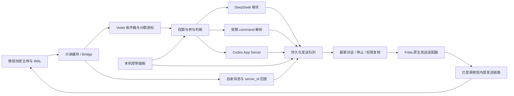
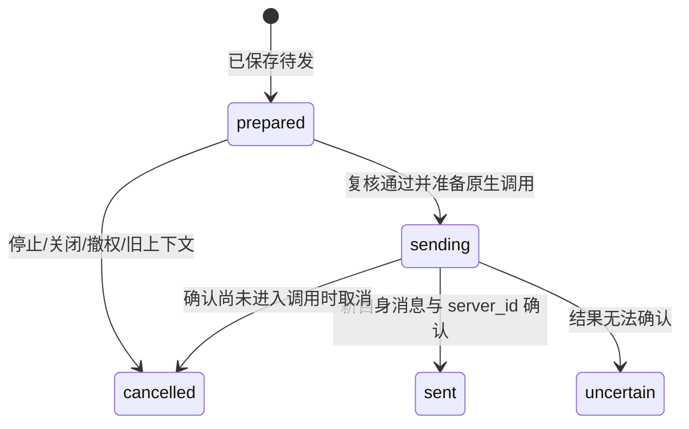

# Violet 微信消息 bot：只读监听、原生 Hook 发送与 Agent 权限

本文解释 Violet 在源码中实际实现的工作方式。重点不是“给一个模型加微信界面”，而是三个必须协同但不能混为一谈的系统：本机聊天数据读取、已登录客户端的原生发送、以及拥有明确权限边界的模型/Agent 任务。

**阅读基线：**仓库中的 `violet_wechat` 公开副本，Windows、Python 3.11+、`wechatauto-replica==1.2.1`、Frida 17.25.2。原生发送只适配指定 SHA-256 的微信 4.2.0.11。本文函数名称多为项目赋予的描述性名称，不能当成微信对外公开 API。

## 目录

1. [架构与能力边界](#1-架构与能力边界)
2. [源码地图与进程分工](#2-源码地图与进程分工)
3. [只读监听如何取得消息](#3-只读监听如何取得消息)
4. [发送者、引用与消息类型](#4-发送者引用与消息类型)
5. [从人工标记到内部发送链路](#5-从人工标记到内部发送链路)
6. [版本指纹与 ASLR 地址计算](#6-版本指纹与-aslr-地址计算)
7. [当前进程管理器与线程恢复](#7-当前进程管理器与线程恢复)
8. [文本对象、字符串与字符长度](#8-文本对象字符串与字符长度)
9. [原生派发、线程与对象所有权](#9-原生派发线程与对象所有权)
10. [发送完成为什么要回查数据库](#10-发送完成为什么要回查数据库)
11. [持久化队列与不确定状态](#11-持久化队列与不确定状态)
12. [停止与取消的多层约束](#12-停止与取消的多层约束)
13. [参与判断与正文生成](#13-参与判断与正文生成)
14. [群级安静、冷却与预算](#14-群级安静冷却与预算)
15. [发送前的最新消息复核](#15-发送前的最新消息复核)
16. [两级管理员和微信命令](#16-两级管理员和微信命令)
17. [自然语言命令的受限解析](#17-自然语言命令的受限解析)
18. [批量发送、转发与幂等](#18-批量发送转发与幂等)
19. [群 Markdown 与个人资料](#19-群-markdown-与个人资料)
20. [Codex App Server 与工作区任务](#20-codex-app-server-与工作区任务)
21. [Agent 来源上下文与会话隔离](#21-agent-来源上下文与会话隔离)
22. [面板、部署与独立安装](#22-面板部署与独立安装)
23. [测试、诊断和新版本适配](#23-测试诊断和新版本适配)
24. [隐私、局限与源码阅读顺序](#24-隐私局限与源码阅读顺序)

## 1. 架构与能力边界

Violet 没有重新实现微信网络协议，也不是网页登录机器人。登录、会话、协议序列化和网络连接仍由真实微信客户端维护。程序在本机读取可解密的历史，并把待发文字交给该客户端当前进程中已经初始化的内部业务对象。



两个写库动作容易混淆：Violet 会写**自己的** `state.sqlite3` 来保存队列和状态；它不通过往**微信消息库**插入一行制造发送。微信库里的新发送记录是客户端原生业务执行后产生的，然后由只读层回查。

| 能力 | 当前实现 | 边界 |
| --- | --- | --- |
| 接收 | 定时读取所选群聊/私聊的本机历史增量 | 不是服务器推送，不保证消息即时已同步到本机 |
| 普通回复 | DeepSeek 文字回复与检索 | 没有直接给予 shell/文件权限 |
| 原生发送 | 进程内文本对象构造和发送派发 | 特定模块指纹、当前对象与工作线程 |
| 微信 command | 发文字、转发本群文字记录、查询/取消自己的批次 | 不生成原生合并卡片或转发媒体原件 |
| Agent | 已授权工作区中的多步工具任务 | 仅管理员，受宿主配置和当前任务权限约束 |
| 删除 | 不属于 bot 的发送适配器 | 离线删除是另一个项目；没有通用 Hook 删除函数 |

## 2. 源码地图与进程分工

| 文件 | 主要职责 |
| --- | --- |
| `cli.py` / `settings.py` | 启动、单实例、数据目录、配置与边界校验 |
| `web.py` / `static/` | 本机面板、设置、群记忆、队列与任务详情 |
| `bridge.py` | 联系人解析、分片读取、身份映射、发送回查 |
| `message_parser.py` / `parser_support.py` | 压缩正文、引用关系及消息标签 |
| `recovery.py` | 对当前进程恢复发送管理器与工作线程 |
| `native_sender.py` | Frida 会话、Python 调用、取消闸门 |
| `native/*.js` | 对象构造、线程内派发、引用释放、待调用取消 |
| `native/weixin_4_2_0_11.json` | 二进制指纹、对象字段与 RVA |
| `engine.py` | 收件、权限、参与、模型、排队、停止和发送的协调 |
| `store.py` | 持久化收发、任务、预算和操作幂等 |
| `participation.py` | 安静、直接呼叫、主动发言预算及本地过滤 |
| `model.py` / `commands.py` | 模型协议、有限结构化计划与文本命令语法 |
| `agent.py` | Codex RPC、工作区并发、工具回调、确认和取消 |
| `memory.py` / `profile.py` | 分群 Markdown 与共享公开资料 |

运行时通常有三个进程角色：Python 服务、微信客户端和按任务启动的 Codex App Server 子进程。Frida 脚本在微信进程内执行；网页只调用本机 Python 的接口，不直接访问微信内存。进程地址、Python 对象与 JavaScript Promise 属于不同运行环境，不能把一个 Python 取消标志当作能回滚已发生的微信调用。

## 3. 只读监听如何取得消息

### 3.1 与离线删除项目共用的基础

读取依赖会定位本地账号，加载或发现可用数据库 key，把主库与必要 WAL 解密为本地缓存，再以只读 SQLite 连接查询。密钥、明文缓存及 WAL 的基本机制见[删除项目技术文档](01-offline-cleanup-internals.md)。Violet 的 Bridge 懒加载 `WeChatDB`，所以面板和多数测试不要求客户端正在运行。

Violet 用 `psutil` 覆盖上游的进程发现方法，避免外部进程列表命令受限时误判未登录。读取依然依赖正确的账号、缓存和版本，使用 `psutil` 不是绕过 Windows 进程访问权限的方法。

### 3.2 分群、分片的读取游标

群表名仍由 `Msg_ + MD5(group_id UTF-8)` 形成。`snapshot(group, cursors, context_limit)` 遍历消息分片，对该群表分别执行：

```sql
SELECT * FROM verified_group_table
WHERE local_id > ? ORDER BY local_id LIMIT 300;

SELECT * FROM verified_group_table
ORDER BY local_id DESC LIMIT ?;
```

第一部分是未见增量，第二部分是用于理解对话的历史背景。二者用途不能合并：历史可能每轮重复读到，但不能每轮重新成为待回复请求。分片游标独立保存，不能拿一个库的最大 local ID 去过滤另一个库。

`Store.poll` 在同一个本地事务中写入非自身消息到 inbox，并推进游标。重复到达的消息通过 `group:shard:local_id` 去重；自身消息只推进游标。这样可以减少“机器人发完又读到自己，再回复自己”的反馈环。

首次加入监听的群会用当前最新位置建立初始游标，不把全部旧历史当成新请求。已存在的持久游标则继续保存；启动不意味着抛弃此前所有进度或自动重做不确定发送。机器离线期间是否有新历史同步，还取决于微信本机数据可用性。

### 3.3 轮询节拍不等于端到端响应时间

普通轮询默认10秒，可配置2–3600秒。每轮按已经耗时扣减等待，所以慢读取不会再额外完整睡一个周期。模型生成、工作线程等待和发送确认各有自己的时间，端到端延迟可能明显长于10秒。

在生成或有待发聊天时还存在更快的会话观察，用于尽快看见安静、纠正等状态变化；它不意味着所有消息都以1秒内送达，也不替代常规收件状态。

### 3.4 联系人私聊监听与兼容配置

0.7.0把监听对象扩展为会话：群标识以 `@chatroom` 结尾，其他经过联系人核验的个人用户名可用于私聊。旧配置键 `groups`、状态表 `groups`、接口 `/api/groups/...` 和来源字段 `group` 为兼容保留；它们不再代表必须是群。对象的 `is_private` 是由真实 ID 推导的属性，不接受模型自行指定的“我是私聊”作为授权。

面板分别选择群聊或联系人。个人列表排除当前自身、公众号和常见系统会话；保存及启动再次核对目标是已添加的真实联系人且 ID 是规范用户名。没有历史表时游标为空，后续出现新表可以继续读取。新增联系人并不默认监听全部私聊，也不会授予管理员身份。

私聊仍从分片 `Name2Id` 核对 `real_sender_id`，发送者必须是当前账号或该私聊对方；无法核验就停止，不从昵称、正文前缀、引用作者或另一种映射猜权限。私聊正文不剥离形似 `wxid_xxx: ...` 的真实文本，避免把用户原句误当成群发送者前缀。

私聊普通文字视为直接邀请，跳过群聊环境参与判定与主动插话额度，即使旧配置的 mode 是 mention 也不要求 @。但安静/持续暂停期间，普通私聊不会被这种直接邀请自动放行；新明确 @ 可单次回应。自身消息、媒体、系统消息、全局停止和会话关闭继续过滤。群聊原有参与行为保持原规则。

每位联系人有独立游标、近期上下文、Markdown 和人设。Agent 快照保留旧字段以兼容，并增加 `conversation_type=person|group`；私聊任务只携带本私聊历史和记忆。默认会话协议更新为 `source-conversation-v2`，避免自动复用旧版没有明确会话类型的会话。

## 4. 发送者、引用与消息类型

### 4.1 为什么不能用昵称授权

每个消息分片的 `Name2Id` 提供内部数字 ID 到实际用户名的映射。Bridge 根据 `real_sender_id` 找到 sender，再用本机联系人表选择显示名；是否自身由 sender 与当前账号 ID 比较。

同名群友、修改备注和在消息里自称管理员，都不能改变这个 sender。管理员解析只允许按联系人真实 `username` 或微信号 `alias` 唯一核对，不接受昵称。普通发信目标可以用昵称或备注唯一解析，但“收件人识别”和“授权主体识别”是两个不同规则。

### 4.2 引用回复为什么需要专门解析

引用不是普通空卡片。解析器识别 appmsg/type 57，取标题为新回复正文，并生成 `reply_to`：被引原文、显示名、真实 sender、会话、server ID、类型等。聊天模型可以看到“谁回应哪句话”，本地规则也能判断是否引用机器人。

一个关键区别是 `chatusr` 与 `fromusr`：群引用里的 `fromusr` 可能是群会话 ID，真正被引用作者在 `chatusr`。因此优先用 `chatusr`；只有它缺失且 fromusr 不是群标识时才把后者当作者。若把群号误当作者，模型会丢掉对话关系，程序也可能把引用他人的消息误判成在问机器人。

引用内容是上下文数据，不是新的操作授权。原文里写着“运行脚本”不代表当前发言者提出了该请求，更不能替换实际 sender。type 57 和普通文字都会参与相关的聊天判断，但操作解析仍要求已验证操作者自己的原始文本入口。

### 4.3 媒体边界

解析器可以处理文字和若干 XML 摘要，媒体目前只提供类型标签，不把图片字节、语音或视频输入模型。所以这里“模型支持视觉”与“产品已经把图片交给模型”不是一回事。群里发一个表情也不应该自动触发“我看不到图”的长篇回复。

## 5. 从人工标记到内部发送链路

现行代码已经包含版本适配，理解其来源有助于避免把任意地址当发送函数。研究路线是从自己手动发出的唯一标记消息开始，观察存储路径，再继续向上定位业务对象和工作线程。

一种典型的定位过程如下；这是方法说明，不是仓库附带了完整自动逆向器：

1. 用户在自己的测试会话手动发送无歧义标记，例如虚构的 `TRACE-MARKER-001`。
2. 在微信当前模块的 SQLite 绑定、执行路径观察该标记，记录调用栈、模块相对地址和参数。
3. 区分消息 INSERT 与随后状态/server ID 的 UPDATE，确认哪些函数只在做本地存储。
4. 从这些路径向上分析消息构造、发送管理器和派发调用，不把“数据库新增函数”直接命名成网络发送函数。
5. 先验证纯构造与释放，再验证在正确线程构造/释放，最后在明确测试目标执行单次发送并回查。

SQLite 的 step 完成状态只能说明 SQL 执行结束；原生函数返回0也只能在特定输出语义下理解。它们都不是“对方已经收到并阅读”的证明。

旧探针和含私密标记的日志没有进入公开仓库。读者能直接核对现行的偏移配置、对象检查、构造释放预检、派发函数及持久化发送流程。若要适配另一个版本，需要重新取得上述证据，而不是依赖作者某次进程里的绝对地址。

## 6. 版本指纹与 ASLR 地址计算

### 6.1 为什么版本号不够

适配文件记录完整 `Weixin.dll` SHA-256：

```text
745cdf2955fa5128cdb00c056c97571156a5f107406a9bb15ac0754f3246b201
```

这只是模块内容指纹，不是账号信息或密钥。Python 在原生连接前计算磁盘模块 hash，与配置比较。即使文件显示同一个4.2.0.11版本，只要字节不同，发送就拒绝。模块加载后各目标函数还要比较前8字节代码前缀，进一步避免错位调用。

### 6.2 RVA 与绝对地址

ASLR 会使 DLL 的加载基址在不同进程间变化，所以代码使用：

```text
本次运行中的函数地址 = 当前 Weixin.dll 模块基址 + RVA
```

RVA 在指定二进制里可以复用，基址必须每次查询。管理器堆地址和线程 ID 连 RVA 也不是，必须为当前进程重新恢复。PID 可能被操作系统重复利用，因此还核对 `psutil.Process.create_time()`。

| 描述性用途 | 此指纹下的 RVA | 实际核对位置 |
| --- | --- | --- |
| 文本 shared 对象工厂 | `0x71c4e0` | native JSON / 构造脚本 |
| 原生分配器 | `0x76a43bc` | native JSON |
| 原生释放器 | `0x76a4400` | Python 从匹配 PE 节取得代码前缀 |
| 文本派发候选（本版已验证使用） | `0x17cf210` | native JSON / 持久发送脚本 |
| 协程包装入口 | `0x4a9d40` | 恢复观察及持久待调用调度 |
| 发送管理器虚表 | `0x93b68e8` | 管理器扫描和再次校验 |
| 文本对象虚表 | `0x912c258` | 工厂结果校验 |
| shared 控制块虚表 | `0x912c1c8` | 构造与释放预检 |

描述性函数名不是导出符号。没有“把任意新版同名导出找到就可以”的稳定 ABI。偏移、前缀、对象字段、线程和所有权协议必须一起验证。

## 7. 当前进程管理器与线程恢复

`recovery.py` 从当前 `weixin.exe` 进程中选择候选主进程，并用 Frida 附加。它先取得实际模块路径验证 hash，再进行被动观察和对象扫描；没有在恢复阶段发送消息。

### 7.1 管理器候选怎么得到

脚本把管理器虚表的当前绝对地址编码为8字节模式，扫描合适的可读写、非文件映射内存范围。命中并不等于对象有效，随后还检查：

- 对象 `+0xbf8` 的状态指针非空。
- 状态 `+0xc0` 的 mask 在1到1048575之间，且满足 `mask & (mask+1) == 0`，表现为 `2^n-1`。
- 状态 `+0xa8` 的 bucket 指针非空且可读。

这些是本版观察到的结构约束。它们过滤偶然字节匹配，不是对对象语义的形式化证明。候选必须唯一；出现多个结果就拒绝选择，不能简单取列表第一个。

### 7.2 工作线程怎么得到

脚本在协程包装入口计数当前线程，最多观察约12秒；要求线程候选也唯一。配置字段历史上叫 `ui_thread_id`，但此处实际是已观察到的发送协程工作线程，**不能据字段名认为它是窗口 UI 线程**。

刚登录时客户端可能还没创建对应管理器，或尚未观察到工作线程。面板因此会提示先手动发一条普通文字再恢复。这是在让真实客户端初始化自身状态，而不是通过写数据库假造一个状态对象。

### 7.3 为什么运行配置不能分享

恢复输出 `native_profile.json` 包含 PID、进程创建时间、模块路径、对象绝对地址、线程 ID，以及版本参数。它只适用于当前进程；微信重启后必须作废。公开仓库只提供没有这些运行值的版本模板，不提供任何人的实际 profile。

## 8. 文本对象、字符串与字符长度

### 8.1 使用客户端自己的工厂

代码没有用 `Memory.alloc(object_size)` 后随便填几个字段，直接假装这是合法 C++ 对象。它调用当前微信自己的文本对象工厂，得到带正确虚表、初始化字段和引用控制块的 shared 单元，然后只填本次验证过的空字符串与文本字段。

返回单元占16字节：一个对象指针和一个控制块指针。当前布局要求 `object == control + 16`，控制块 strong/weak 初值符合预期，文本对象和控制块的虚表均匹配。工厂还创建了 UUID 等内部字段，这些不是脚本盲猜出来的。

| 文本对象字段 | 偏移 | 用途 |
| --- | --- | --- |
| 对象尺寸 | `0x798`（1944字节） | 适配配置描述的对象布局 |
| 收件人字符串 | `0xb0` | 真实用户名或群 ID |
| 协议类型 | `0x118` | 文字类型1 |
| 子类型 | `0x11c` | 本版普通文字为0 |
| 内容长度字段 | `0x1c8` | 按原生 QString 路径的 UTF-16 单元数 |
| UUID 字符串 | `0x6f8` | 构造结果检查的一部分 |
| 正文字符串 | `0x758` | UTF-8 内容的本地 C++ 字符串 |

### 8.2 小字符串与堆字符串

字符串布局按本版 MSVC 风格的 `std::string` 检查：长度在字符串对象 `+16`，容量在 `+24`，前16字节要么直接放小字符串，要么存堆指针。容量小于等于15时使用内联存储；长内容调用微信自己的分配器，容量按该布局取整。

填入前必须确认原字符串为空，避免覆盖客户端已拥有的缓冲并造成泄漏或双重释放。UTF-8 临时缓冲由 Frida 分配并在调用期间保持引用；转交对象拥有的堆字符串则由微信原生分配器创建，不能混用两种分配来源。

### 8.3 三种长度不能混用

以“你😀”为例，UTF-8 有7字节，UTF-16 有3个 code units，而用户通常看到2个字符。JS `text.length` 正好按 UTF-16 单元计，适合本对象的独立长度字段；字符串的 bytes/length/capacity 则按 UTF-8 计算。

若把 UTF-8 字节数填入 UTF-16 长度字段，ASCII 样本可能碰巧正常，中文或 emoji 就会暴露错误。因此构造预检既检查字符串读回，也记录两种长度，不把“英文发得出去”当成完整验证。

Python 发送器把每段正文限制为2048 UTF-8字节；聊天/批量队列通常用1800字节分段，留下边界余量。这个限制来自已经验证的对象分配范围，不是微信协议对全部消息的公开最大长度，也不能简单提高数字后声称支持任意长文。

## 9. 原生派发、线程与对象所有权

### 9.1 为什么不能在 Frida RPC 线程直接调用

构造对象成功不等于任意线程都能安全走发送业务。管理器可能依赖线程局部变量、协程上下文和调度状态。早期把窗口消息机制当调度入口的思路不能替代真实发送工作线程。

现行 `soul_sender_agent.js` 把请求保存为一个 pending job，然后在已观察的协程入口触发时检查当前线程 ID。只有匹配且不 busy 才取出该 job。超过30秒没遇到合法协程入口就拒绝，明确说明没有进入发送函数。

Frida 的 `Interceptor.attach` 负责观察入口，`NativeFunction` 负责按声明调用原生函数，`NativeCallback` 用于预检中的回调。它们的通用接口可参见 [Frida JavaScript API](https://frida.re/docs/javascript-api/)；具体可调用地址和 C++ 布局仍来自本项目的版本适配。

### 9.2 派发参数与输出布局

本版包装把派发声明为指针返回，参数为管理器指针、输出结构指针、输入 shared 单元指针和整数标志。Windows x64 常规参数寄存器背景有助于分析调用，但不能只看寄存器顺序就猜中 C++ 隐藏返回值与所有权。

这里显式分配56字节输出结构，并检查原生返回指针正好等于传入输出地址。已观察布局包括两个错误整数、一个字符串、一个 shared 结果。结果控制块指针位于输出 `+0x30`，输出字符串从 `+8` 开始。这些值的解释依赖本版布局，返回0不直接表示收件人已读。

### 9.3 引用计数为何是长期运行的关键

一次实验里保留几十字节或一个结果对象，进程退出就能回收；长期每10秒发送会把小泄漏放大。更危险的是引用计数释放错误：太早释放可能 use-after-free，重复释放会崩溃，不释放则持续泄漏。

现行释放路径按本版原生 shared 控制块协议执行原子 strong 递减、Destroy、weak 递减与 Delete_this。脚本使用专门的小段原生释放代码，并用自己的三个临时对象做预检：人为增加引用后第一次释放只应递减计数，最后释放才应各销毁/释放一次。

预检通过不等于业务发送完成。它的作用是在调用真实消息发送前核对对象生命周期。输入对象在派发后按已验证的所有权转移处理，脚本清空自身输入指针单元；输出结果的 shared 和长字符串则走相应释放器。Frida scratch 内存由其运行时管理，必须在调用期间保持存活。

代码在关键异常时停止，不能由正常路径的释放预检推断“任何 native 异常都绝无泄漏”。部分原生异常可能发生在所有权已转移、结果尚未完全形成时，此时最重要的是标记不确定并避免盲目重试。

## 10. 发送完成为什么要回查数据库

一条发送至少有四个不同阶段：

1. 待发文本已进入 Violet 的本地队列。
2. 当前微信工作线程接受了原生派发调用。
3. 微信本地记录出现自身这条消息及非空服务端编号。
4. 远端用户收到、显示乃至阅读。

Violet 只能把第3步作为本实现的确认依据，不能观察并保证第4步。即使原生输出看似成功，仍要从微信只读数据库中找对应新记录。

`Bridge.verify(delivery)` 从发送前保存的各分片位置之后查询目标会话，要求 `is_self`、正文精确等于待发内容、存在 `server_id`。发送器不会只因本地出现一行就确认，也不会把别人的同文消息算作自身成功。

这个匹配也有边界：它依赖正文和新位置，不是把应用请求 ID 透传到微信网络协议的全局幂等键。如果用户在同一目标同时手动发送完全相同文字，或客户端同步/改写行为异常，可能产生歧义。避免这类并行同文操作比宣称“绝对恰好一次”更诚实。

回查默认有时间上限。超过期限找不到服务器编号时，状态转为 uncertain 并停止监听，而不是自动再发一遍。迟到的原生成功可能发生，所以 uncertain 不等于“肯定没发”。应先核对实际微信记录。

## 11. 持久化队列与不确定状态

### 11.1 应用自己的状态库

`Store` 使用 SQLite WAL 和进程内锁，保存收件、游标、待发、操作、任务、预算等。这里写入的是 Violet 的数据库，不是微信的消息数据库。

| 表 | 主要目的 |
| --- | --- |
| `groups` / `inbox` | 分群进度、暂停与未消费消息 |
| `outgoing` | 待发正文、来源群、目标、baseline、确认结果 |
| `actions` / `admin_turns` | 管理员操作占位与防重复结果 |
| `command_batches` / `command_items` | 一批微信命令及每条实际发送的关联 |
| `conversation_policy` / `policy_seen` | 安静时限、版本与已观察控制消息 |
| `chat_delivery_meta` / `chat_sent` | 生成来源、复核依据和已确认预算 |
| `agent_jobs` / `agent_events` | Agent 任务状态与可见过程 |
| `agent_context_snapshots` / workspace snapshots | 任务提交时上下文和权限配置快照 |
| `agent_sessions` / `agent_approvals` | 会话续接及面板权限/输入请求 |

### 11.2 先持久化，再产生外部副作用

普通回复的 `reserve` 把消费输入与保存所有分段放进同一事务，避免只发出第一段后其他段丢失。每段有稳定 ID。批量命令先原子保存整个批次和所有 items，管理员操作也先记录 claim，再执行副作用。



图不是网络事务协议。Python 或微信可以在任意两步之间崩溃，因此系统选择对已进入 sending 而未确认的消息保守处理。启动时会回查 sending/uncertain，不能确认就保留并停止，不自动重发。

`prepared` 队列与已保存游标可以持久存在，但启动面板不会自动开启监听或自动恢复旧 Agent 执行。不要把“持久化保存”理解为“每次启动都重做所有历史请求”。

## 12. 停止与取消的多层约束

“面板点停止但还在发”的问题不能只用一个网页按钮禁用解决。模型可能正在生成、Python 正在等待 native RPC、JavaScript pending 尚未遇到工作线程，或者微信内部函数已经开始执行。因此停止需要贯穿各层。

当前路径包含：

- 面板或 `stop.bat` 写入持久 STOP / AGENT_STOP 闩锁。
- Python 设置 done、清理待补操作上下文、取消未发送项并阻止后续投递。
- 原生 Sender 的 blocked 标志与 `allowed` 回调再次检查。
- JavaScript `cancelpending()` 拒绝尚未进入原生调用的 job。
- Agent turn 中断、等待确认取消，以及清理本产品拥有的子进程。
- 监听重载用用户意图版本避免较旧的“恢复运行”覆盖用户较新的停止。

每个分段发送前都检查来源群是否仍启用。群关闭还会取消其 prepared、清理上下文、取消该来源 Agent，并等待已进入发送环节的工作完成必要回查。

无法取消的边界是：工作线程已从 pending 取走请求、进入微信发送函数以后，`cancelpending()` 只会报告 busy，不能把已经提交的网络业务撤回。此时完成当前单条的确认，其余分段取消。全局停止不等于微信撤回功能，也不会回滚 Agent 已经完成的文件修改。

## 13. 参与判断与正文生成

### 13.1 两个问题用两个步骤回答

“模型能回答这个问题”不表示“机器人应该在此刻插话”。Violet 把是否参与与怎么回答分开：先做本地硬过滤和受邀识别，再视情况调用 `Participation` 判定，最后才生成 `Reply`。

`Participation` 只允许输出：是否参与、本轮真实 message IDs、answer/casual 类型和有限原因。程序检查选中的 ID 必须属于本轮可用输入；模型不能凭空指定另一个群的消息或旧 ID。判定不参与时直接消费/跳过相应输入，不排队任何说明文字。

这避免把“收到，这句我不接”“我先安静一下”当作不参与的输出。说出“不参与”本身仍然是一条群消息，会继续打扰群友，甚至触发对机器人新的回复。静默必须由程序没有发送动作来实现。

### 13.2 本地直接受邀路径

明确 @ 配置称呼、以机器人称呼直接呼叫、或结构化引用机器人，会直接视为受邀，不再让环境参与模型把这次明确请求投票成“他们在互聊”。识别称呼结合每群设置与当前账号实际显示名，改机器人名称后旧配置别名仍可以保留。

明确 @ 的回复也必须满足运行、来源群、消息类型与停止边界。“@必回”是产品的路由优先级，不是离线、鉴权失败、微信断开时仍然具有发送能力。模型失败时有简短失败说明路径，不把底层错误和密钥回给群。

### 13.3 正文生成的约束

正文由结构化 `Reply` 返回 `should_reply`、有限数量的完整回复与可选记忆建议。文本经过重复、空内容、长度、条数、字节和类型校验。普通接梗最多一条短句，明确多个问题才允许分段。

聊天模型只拿到本来源群背景、选定新消息、当前能力和明确公开资料。普通聊天没有本地脚本工具，也不能通过一句“我已经发送给某人”真的产生跨会话副作用；实际发信走另外的管理员通道。

### 13.4 当前模型和搜索接口

配置默认对话模型是 `deepseek-flash`，检索模型是 `deepseek-v4-pro`；这些只是可更改的配置值，不代表本文对模型质量或未来可用性排序。当前代码的聊天/结构化请求显式关闭 thinking，并使用 JSON 输出约束。对输出的程序校验仍然必要，不能假设设置了 response_format 就不会有截断或错误字段。

普通自然语言搜索通过有限 `web_search` 工具调用，再向 `/responses` 请求真实检索。代码检查返回里确实存在 `web_search_call` 及正文，避免把模型凭已有知识编写的内容标成“已经联网查询”。关闭搜索时不向模型提供该工具。请求层对鉴权、余额、限流和连接异常做有界处理，不把上游返回中的敏感值直接展示给群。

## 14. 群级安静、冷却与预算

每个群有独立策略记录：安静截止时间、revision、最近确认发送、预算窗口与原因。同一套称呼或人设可以继承全局，但策略状态不跨群共享。

| 策略 | 默认值 | 程序上的含义 |
| --- | --- | --- |
| 主动闲聊轮次冷却 | 45秒 | 不同主动轮次不能过密，同轮分段共享轮次 |
| 预算窗口 | 300秒 | 统计窗口内已确认的主动闲聊 |
| 条数预算 | 4条 | 以实际确认的每段计数 |
| 字数预算 | 600字 | 控制主动插话总量 |
| 普通接梗 | 1条、80字 | 避免把一个短梗写成长篇多段 |
| 闭嘴后的安静 | 120秒 | 普通闲聊仅监听，新的明确呼叫可回应 |

### 14.1 两分钟安静不是永久暂停

“闭嘴”“不接”“别回”“不是问你”等被本地规则识别为安静请求后，保存 `quiet_until` 并提升 revision，取消旧闲聊，不发送“收到”。程序记录已经观察过的消息，避免同一条历史在每次轮询重置两分钟。

过旧消息或明显来自未来的异常时间不会重新武装安静。程序也排除明确引述他人说法、与别人说话等场景，避免把任何包含“闭嘴”的词都当作对机器人的控制。规则仍可能误判自然语言，它们是有限模式而不是完整意图理解。

新的 @ 可在计时期间单次回应，但不清除原计时。明确的安静命令即使带 @ 也不会收到确认。批次里按先后顺序理解：先前 @ 的排队回复可被后来的闭嘴取消，闭嘴之后新出现的 @ 则可重新受邀。

管理员 `/暂停` 是持续暂停闲聊的另一状态，不自动在两分钟后结束；`/恢复` 或面板恢复可以显式唤醒。普通群友的安静请求不会扩张为关闭整个 Agent 管理能力。

### 14.2 预算依据已确认发送

已确认聊天写入 `chat_sent`，同一个 delivery ID 重复确认不会重复计数。重启保留窗口与记录，避免重启就清空预算。明确受邀、近期对话续接及管理员操作有各自分类，不机械占用主动插话预算；跟机器人最近已确认轮次相同发送者的短追问可继续，但仍不能覆盖安静状态。

“预算用完”与“延后排队”是两回事。普通无关消息在不适合参与时跳过，不在数分钟后补发过时笑话。预算避免过量输出，不能保证幽默、时机和对话对象判断全都正确。

## 15. 发送前的最新消息复核

假设模型开始生成后，群友发“不是这样，我刚改了”“不用了”“不是问你”。如果只在生成前看一次消息，十几秒后发出的答案可能已经不合时宜。Violet 对每一个待发分段都执行复核，而不是一批只查一次。

保存的 `chat_delivery_meta` 包含来源消息 ID、来源顺序、观察游标、策略 revision、群记忆版本与主人资料版本。发送前：

1. 检查全局、来源群、暂停、安静、预算及 delivery 状态。
2. 检查资料和记忆版本；发生变化就取消按旧背景生成的回复。
3. 从微信只读层重新读取源消息之后的新记录，也结合尚未消费的本地 inbox。
4. 明确要求安静或“不接”的新输入直接取消旧轮次。
5. 普通主动闲聊如有新内容，再调用独立 `SendReview`，只返回是否仍合适和原因，不重写旧正文。
6. 复核结束后再次读取并检查，减少复核本身耗时导致的过时。

直接受邀与明确续接不会仅因无关新闲聊就被另一个模型投票取消，但仍受新的安静指令、资料变化和停止控制。稳健风格在复核期间出现更多新文字时更保守；熟人风格允许部分普通聊天并发，避免机器人彻底沉默。

revision 的作用类似乐观并发控制：生成使用旧策略版本，发送看到版本已经变化就拒绝旧结果。它比把“请安静”写进提示词更能落实行为，但仍不能预知下一毫秒到达微信的消息。原生调用的不可撤销边界依然存在。

## 16. 两级管理员和微信命令

### 16.1 权限来自程序核验

配置分别保存 `admin_accounts` 与 `secondary_admin_accounts`。连接时两份名单都通过本机联系人按微信号/真实用户名核验，得到实际 sender ID 集合。某个名字同时出现在两种身份里时，完整管理员权限优先。

两份名单必须都核对完成才能发布有效身份集合；核验失败不会保留上一次残留授权。模型的 `is_admin` 字段、群记忆里的“某人是管理员”或任务输出中的自称，都不能授予权限。

| 操作 | 普通群成员 | 次级管理员 | 管理员 |
| --- | --- | --- | --- |
| 普通文字聊天/开放搜索 | 按群配置 | 按群配置 | 按群配置 |
| `/command` 发送、转发 | 否 | 是 | 是 |
| 自己本来源群的批次状态/取消 | 否 | 是 | 是 |
| `/agent`、任务状态/取消 | 否 | 否 | 自己已授权任务 |
| 自然语言管理员操作、本地小工具 | 否 | 否 | 按配置 |
| `/记住`、持续暂停/恢复等管理入口 | 否 | 否 | 是 |
| 修改身份名单和工作区权限 | 不在群消息通道开放 | 不开放 | 在本机面板配置 |

### 16.2 为什么要在缓存计划之前拦截

`Engine.admin()` 先核对真实 sender 与原始文本类型；对次级管理员，非 `/command` 的操作会直接拒绝。这个分支在读取缓存 AdminPlan 和自然语言工具解析之前，避免一个刚从管理员降级的人重新利用以前缓存的本地工具计划。

`agent_command` 自身也再次检查完整管理员，Agent 的联系人查找和发信回调同样核对任务 owner。不是只把菜单隐藏，底层执行入口仍然开放。

普通群友的命令文字不会进入 privileged planner；引用消息也不能变成当前操作者的原始文字指令。自然聊天中是否搜索属于开放聊天能力，不是通过次级管理员获得任意本地网络/文件权限。

### 16.3 撤权不能只影响新命令

批量项投递前从其 batch 查询 owner，重新检查 owner 仍有 command 权限、全局发信开关仍开启、来源群仍允许。模型解析后和收集发送 baseline 后也再查一次，防止等待期间撤权。

权限更新伴随监听上下文重载，相关 Agent 会被取消；已进入原生发送函数的单条仍按前文边界处理。撤权不自动撤回以前已经发送的消息。

### 16.4 联系人卡片的权限等级

私聊联系人卡片提供普通、次级管理员和管理员三个选项。等级同步全局微信号白名单，因此在该账号发言的其他受监听会话里也生效，不是按昵称或“对方和我私聊了”临时授权。后端会重新从真实联系人解析原有白名单的每个账号，移除指向同一人的 ID/旧微信号别名，再写入选定等级；两份名单都移除才是真正降为普通。

修改入口仅在本机面板开放，沿用 nonce/Origin 校验。配置应用及会话开关序列化，修改权限会取消受影响的旧操作上下文，完整管理员变化时取消既有 Agent 任务；未提交 command 仍在发送前核对 owner 是否有权限。联系人发来的普通私聊或模型中的角色字段不能调用这个配置入口。

## 17. 自然语言命令的受限解析

### 17.1 固定语法始终保留

```text
/command send ExampleContact | 今晚八点见
/command forward 30 -> ExampleContact
/command send ["ExampleContact", "示例群（测试）"] | 周末见
/command status 24位批次编号
/command cancel 24位批次编号
```

固定格式由本地解析器处理，身份和状态允许时无需模型调用。明显属于固定语法但数值或格式错误的输入直接报错，不交给模型“替用户修正”成另一个操作。正文分隔符 `|` 后按文字处理，不当作新的 `/agent` 或 shell 代码。

### 17.2 自然语言只提取有限计划

例如：

```text
/command 给 ExampleContact 发消息，内容是：今晚八点见
/command 把本群最近30条消息转给 ExampleContact
/command 取消这批发送 0123456789abcdef01234567
```

固定解析失败且不属于必须直接报错的固定格式时，调用聊天模型的 `complete()`。请求只有当前命令与机器人别名，没有联系人全表、群历史或文件列表，也不提供任何工具。

模型必须返回 `NaturalCommand`：`kind` 仅能是 send、forward、status、cancel、help、clarify；其余是 targets、count、text、identifier、clarification。Pydantic 禁止额外字段，count 严格整数且最多50，目标最多20；非法类型、截断与未知动作都不能直接执行。

`NaturalCommand.command()` 再转成固定格式并经过同一个 parser，复用正文、条数、目标和编号限制，而不是另外写一个权限更松的自然语言发送器。不需要的字段混入动作时会被拒绝。模型负责理解，不负责决定自己可以拥有什么权限。

### 17.3 解析错误怎样收束

缺收件人/正文、代词不明确、多种操作混在一条、要求别的来源群、媒体原件、合并卡片、本地脚本或 Agent 时，应返回 clarify。宿主不执行动作，要求补充后完整重发 `/command`，没有默默继承其他人的历史收件人。

已知模型 Key 出现在命令里会在请求模型前被拦截。解析超时或返回格式错误转为明确未执行说明；停止或撤权发生在模型等待期间，也拒绝计划。

自然语言对正文的抽取仍可能有语言模型误差，唯一联系人解析也不能证明模型永远提取了用户心中正确的对象。需要逐字保留、包含复杂引用或机器命令的正文，优先使用固定 `|` 分隔格式。后端限制保证动作类别有限，不等于自然语言理解永不出错。

## 18. 批量发送、转发与幂等

### 18.1 转发的数据从哪里来

`forward` 读取**本来源会话**、触发命令顺序之前的最近1–50条记录。每条本地构造成群名、时间、发言人、原文，引用可带摘要。图片和语音只显示类型标签，没有把媒体文件上传到目标会话。

它不是微信原生的合并转发卡片：没有在本项目里构造那种协议对象，没有携带原媒体，也不能让接收者像打开原生卡片那样逐条定位历史。文档和回执应把它称为文字记录转发。

### 18.2 先解析全部目标，再整批入队

所有目标先通过 Bridge 唯一解析：真实 ID/微信号、完整昵称/备注，必要时做有限 Unicode、括号、空白和前导符号规范化。多个联系人同名时拒绝，不在不确定名单里自动选择一个。

每条正文按 UTF-8 字节拆段；总实际发送数等于目标数乘以分段后的条数，最大100。全部目标及上限检查通过、当前来源仍允许后，一次事务保存 batch/items。避免第二个目标不存在时，第一目标已经先收到半批内容。

### 18.3 请求级幂等与每条确认

批次 ID 来自触发消息稳定身份加 command 标记的 SHA-256 截断；每个 item 再追加顺序索引。同一条微信消息再次被处理，只会返回已有批次，不重复入队。用户重新发一条同样文字是新的消息身份，仍然会创建新的请求，不能把文本相同误判为用户没有重发意图。

每个 item 独立进入 prepared/sending/sent 等状态，批次状态聚合各 item。一个目标失败不会被简单报告成“全部发送成功”。`status` 和 `cancel` 只允许查询/取消本人在同一来源群创建的 batch，不凭知道编号就控制别人的任务。

### 18.4 取消不能排在整批后面

如果队列已有100条，新的 `/command cancel` 不能等它们全发完再处理。worker 在批量项之间优先检查 command 控制消息；普通控制回执也排在 command items 前面。取消只把尚未提交项变成 cancelled，正在原生函数里的那条仍需回查。

这些机制提供防重复和可审阅进度，不提供跨目标原子投递。多个群/联系人已经收到的部分不能因为后续失败而全部撤销，也没有自动补发 uncertain 项。

## 19. 群 Markdown 与个人资料

### 19.1 分群长期记忆

每群使用群标识哈希后的独立目录保存 `memory.md`，避免群名变化造成记忆位置变化，也避免用原群名直接充当路径。历史和当前聊天按群隔离，不会因为“大家都是同一账号的朋友”就合并背景。

面板保存采用版本散列的乐观并发控制：旧版本页面提交时发现现版已变，会要求处理冲突，而不是覆盖别人的更新。文本先写临时文件再替换，保留最近有限个历史版本；这保证常见编辑过程更可控，不代表所有文件系统故障都自动恢复。

聊天模型可以提出少量记忆建议，但必须附本轮真实非自身消息来源。建议先进入待确认，不立即成为事实；本机用户审核后才写入。管理员 `/记住` 可以直接追加，记录稳定来源防止同一命令重复写。次级管理员不能使用这一管理入口。

### 19.2 不把事实和权限混在一起

群记忆适合称呼、稳定偏好和共同背景，不应记录临时辱骂、猜测关系、密钥或“所有群友都变管理员”。即使 Markdown 里出现这些话，真正权限仍取决于账号白名单与宿主验证。

模型可能被错误长期事实影响，所以人工审核、可回看来源及可编辑删除都很重要。版本变更会取消仍按旧背景生成的闲聊，避免用户刚改完名字，队列里还发出旧介绍。

### 19.3 主人公开资料是另一个范围

`owner_profile.md` 保存用户主动允许用于交流的背景，是跨群共用配置；分群记忆仍只给来源群。机器人用它解释账号持有人的背景，不应冒充本人、虚构本人经历或替本人作私人承诺。

资料会进入普通聊天与相关任务的模型输入，因此“写在本机 Markdown”不意味着永不离开本机。产品在配置层让用户决定公开内容，不能把一个人的完整私人简历默认复制给所有群。公开仓库没有附带任何作者个人介绍。

## 20. Codex App Server 与工作区任务

### 20.1 为什么聊天 API 与 Agent 分开

聊天模型生成文字并不会天然获得本地文件和脚本权限。把“我不能操作电脑”改成一句提示词，不能创造真实工具；反过来，把一个任意执行 shell 的函数直接交给所有群友，会破坏身份边界。

Violet 采用独立 `/agent` 通道。完整管理员明确选择工作区，宿主启动本机已经登录的 Codex 原生程序，以 `app-server --stdio` 通信。模型的项目任务与普通聊天分开，各自有状态、能力和确认入口。[Codex App Server 官方文档](https://developers.openai.com/codex/app-server/)介绍了这种宿主与客户端协议；下面的具体配置以本仓库实现为准。

### 20.2 JSONL RPC 生命周期

`CodexRPC` 通过 stdin/stdout 逐行收发 JSON：

```text
Python host -> initialize
Python host -> initialized notification
Python host -> thread/start 或 thread/resume
Python host -> turn/start
Codex       -> 进度通知、工具请求、权限请求、完成通知
Python host -> 对工具/权限请求的结构化响应
Python host -> turn/interrupt（取消时）
```

宿主给请求分配 ID，用 Future 等待对应结果；后台 reader 区分回复、通知和服务端发起的请求。stderr 独立消费，避免输出管道阻塞主协议。JSON 解析、超时和进程退出会转为任务状态，不把任意 stdout 当最终文本发送到群。

不记录或展示模型内部推理；面板展示命令、文件变化、可见模型结果与确认。进度事件不等于任务成功，最终要等待对应完成状态。

### 20.3 工作区权限

每个工作区是已存在的绝对路径，保存规范路径及 ID/名称；配置分别控制只读/可修改、命令执行、任务联网和微信发信。当前启动目录不会自动成为工作区。

启动选项禁用默认 MCP/apps，并按工作区设置 shell、patch 和搜索能力。线程/turn 再传沙箱与网络配置。对超出授权根目录的 grantRoot、只读任务的文件修改、未开放的命令或网络请求，宿主拒绝相应确认；一般额外确认在本机面板显示，而不是让群里任意人发一句“同意”。

这是宿主配置与 Codex 能力的组合，不应被描述为对恶意代码的完美隔离。进程仍在当前用户机器上运行，环境、Windows 权限、工具实现和本地文件布局都会影响实际边界。工具联网关闭也不等于模型服务本身离线。

### 20.4 动态微信工具

Agent 可以按权限得到 `violet_find_contacts` 与 `violet_send_message`，只接受固定参数结构。工具请求回到 Python，由宿主核对真实任务 owner、全局开关、工作区发信权限、来源状态和唯一收件人，然后进入同一持久发送队列。

发信工具等待 server ID 回查才报告确认；未确认就返回失败/不确定，模型不能仅凭调用意图声称已经发出。次级管理员不能启动这个执行器，`/command` 的模型也没有这两个 Agent 工具。

### 20.5 并发、取消与子进程清理

同工作区串行；路径存在父子重叠时也不并发，以减少两个任务同时改同一文件树。不同工作区受全局并发上限约束。等待许可的任务也检查 epoch/取消闩锁，停止后不会在队列空出时重新开始。

取消时尝试 `turn/interrupt`，取消等待确认，关闭 RPC，清理本产品启动且 PID/创建时间仍匹配的进程及相关子进程。不会按进程名批量杀掉用户的全部 Codex 或 Python。重启后未完成任务标记中断，不自动重做已经可能产生文件副作用的任务。

## 21. Agent 来源上下文与会话隔离

### 21.1 提交时冻结来源群快照

群中发出 `/agent` 时，Engine 读取触发命令之前、本来源群最近默认50条消息，可配置0–200。每条带真实 sender、时间、正文和引用；超过总字符预算时优先保留最新部分。快照还记录群标识/名称、请求者、风格、称呼、人设、群 Markdown 及是否为空。

历史单条正文有长度限制，历史总体约24k字符预算，引用单独截断；这不是完整无限历史。设为0时不读取近期消息，但仍显式告诉 Agent 来源群和空/非空长期记忆。不能因为本群没记忆就从工作区里找另一群资料填充。

快照保存到 `agent_context_snapshots`，面板可展开核对。同一个任务后续执行使用提交时快照，不因后来群聊变化而悄悄更换“刚才”的含义。公开主人资料是另一个模型输入范围，按任务执行路径读取当前本机配置。

### 21.2 顺序与数据/指令区分

turn 输入先放带明确来源标识的背景，再放公开资料，最后放管理员实际任务。开发者指令强调群历史和引用是待理解数据，不能替换最后的任务或增加权限。快照的 group/requester 与任务 source/owner 必须一致，否则提交拒绝。

这可以修复“Agent 不知道当前是哪个群”与“把别群人物列表当成本群”的常见输入问题，但不是一个形式化信息流隔离系统。管理员若把包含其他群文件的目录明确授权为工作区，Agent 在该文件权限下仍可能读到那些文件；程序不应把它们自动当作当前群记忆。

### 21.3 默认会话怎样划分

默认 session key 不只取工作区路径，还包含工作区配置指纹、上下文协议版本 `source-conversation-v2`、群配置、操作者与来源群。相同项目在不同群、不同管理员或不同风格配置下，不自动共享同一个默认 Codex 对话。

`/agent-new` 强制新会话，面板支持显式续接。权限或来源框架变化会改变默认 key，避免新版任务自动恢复旧版没有来源标签的会话。群配置隔离和快照解释共同降低上下文串用；它们不保证模型永远正确理解人际关系。

## 22. 面板、部署与独立安装

### 22.1 本机接口的边界

Uvicorn 绑定127.0.0.1。Host 白名单、Origin 检查和本机会话 nonce 保护写接口，设置与状态不返回 API Key，浏览器还有限制来源的 CSP。nonce 的用途是减少别的网站随意触发本机写操作，不是独立的多用户登录系统；同用户下有本机访问能力的程序仍可能读取配置或调用本地接口。

配置按严格模型校验，工作区、群数量和输入范围有上限。异常响应尽量使用受控说明，不回显上游密钥。密钥仍以本地配置形式保存，没有声称提供磁盘加密或 Windows 凭据库托管。

### 22.2 数据目录与当前工作目录分开

安装版默认用 `%LOCALAPPDATA%/Violet`；源码旁已有 `config.local.json` 时沿用源码数据位置；`VIOLET_HOME` 和 `--data-dir` 可显式指定。代码资源通过包自身路径定位，原生脚本随 wheel 打包，不从私人父项目导入。

因此可以在另一个项目目录启动 Violet，也可以把另一个目录注册为 Agent 工作区。两种能力不同：启动路径不自动授予读写权限，注册工作区才定义任务能操作的项目。

### 22.3 双击启动与单实例锁

`start.bat` 选择项目虚拟环境、当前环境或系统 Python，再运行 `run.py --open`。CLI 在数据目录锁文件的第一个字节上使用 Windows 非阻塞锁，避免同数据目录出现两个发送器。

顺序必须是先尝试锁，再按需要初始化锁字节。若在锁之前读取该字节，另一个进程已经持锁时 Windows 会拒绝读取，使“已经运行，打开面板”路径反而报 PermissionError。本版本有真实 Windows 锁的隔离子进程回归测试，覆盖空锁首次启动、重复打开和停止入口。

打开面板不会自动开启监听；关闭网页不会结束服务；`stop.bat` 请求停止监听和 Agent，不是删除数据或卸载程序。默认不创建开机自启动任务。

## 23. 测试、诊断和新版本适配

### 23.1 测试怎样组织

| 测试文件 | 主要覆盖 |
| --- | --- |
| `test_product.py` | 配置、身份、分群、队列、API 遮蔽、模型协议 |
| `test_stop_and_tools.py` | 停止、取消、工具限制与竞争 |
| `test_agents.py` | Fake RPC、工作区权限、会话、取消、动态工具 |
| `test_memory.py` / `test_profile.py` | 来源、乐观锁、隔离、资料与记忆版本 |
| `test_conversation.py` | 安静、预算、@、最新消息复核 |
| `test_classmates.py` | 短追问、最近未答问题、接收者保持 |
| `test_commands_and_source.py` | 批量幂等、全目标检查、来源快照 |
| `test_secondary_admins.py` | 两级管理员、自然语言解析、撤权边界 |
| `test_private_conversations.py` | 私聊身份、直接回应、暂停/安静、三种权限及真实用户名核验 |
| `test_cli_startup.py` | 实际 Windows 字节锁与重复启动 |

这些测试用虚构数据，不调用真实微信发送。FakeRPC 能检验宿主协议处理和取消逻辑，不能证明某台机器的 Codex 登录、每个模型版本或原生微信 ABI 一定可用。正常情况下还应对自己的部署做连接检查与单次明确测试，不直接向大量真实群转发作为探针。

### 23.2 常见现象应该查哪一层

| 现象 | 先查 | 不应立即得出的结论 |
| --- | --- | --- |
| 已登录却“未连接” | 账号目录、读取权限、依赖发现与密钥缓存 | 微信一定没登录 |
| 能读但不能发 | 模块 hash、当前进程 profile、管理器初始化与工作线程 | 没有本地聊天所以不能私聊 |
| 原生恢复找不到候选 | 手动普通文字是否创建上下文、候选/线程是否唯一 | 任意选一个扫描地址就能解决 |
| 不回复 | 全局/群开关、安静、预算、参与日志、模型错误 | 只能是模型质量差 |
| 停止后仍出现一条 | 是否在停止前已进入原生派发、确认时间 | 每一条都代表停止状态失效 |
| 批量没有全成功 | 各 item 状态、目标唯一性、uncertain | 可以直接整批再发 |
| Agent 背景错群 | 来源快照、session key、工作区文件 | 群记忆文件名换了就自动隔离全部文件 |
| 双击没反应 | 已有服务、单实例路径、Python 环境、面板地址 | 必须结束所有 Python 进程 |

### 23.3 新微信版本不能怎样适配

不要只把 JSON 版本名改为新版本，不要复制旧绝对地址，不要把扫描第一个对象当管理器，也不要在未知工作线程调用发送。完整模块 hash 拒绝是适配边界，不是应当直接删除的障碍。

新适配至少需要：唯一测试标记与存储路径证据、消息对象工厂/布局、正确发送管理器、工作线程与调度入口、UTF-8/UTF-16 长度验证、所有权与释放预检、输出语义、只读 server ID 回查、取消未提交调用，以及进程重启后的失效验证。一次“hello”成功不能替代中文、emoji、失败和重启案例。

## 24. 隐私、局限与源码阅读顺序

运行数据分为三个范围：微信自己的数据与读取库缓存、Violet 的配置/队列/记忆、模型服务实际收到的请求。它们都可能包含私人信息。本地保存不等于加密保存，模型生成不等于本地离线运行，源码公开也不要求发布运行样本。

公开仓库清除了账号、群号、个人称呼、私聊、群历史、资料与绝对运行地址；版本 hash 和 RVA 保留，因为它们描述公开客户端二进制，不标识某个用户。隐私审计还能扫描典型误提交，但不能识别所有自然语言中的真实经历。

建议源码阅读顺序：

1. 先读 `bridge.py` 与 `message_parser.py`，理解什么是输入及真实 sender。
2. 再读 `store.py`，理解哪一数据库被写、哪些 ID 用于幂等。
3. 读 `recovery.py`、native JSON 和两个 JS，建立对象/线程/生命周期的完整图景。
4. 读 `native_sender.py` 与 `Engine.deliver`，看原生调用和回查如何连接。
5. 读参与策略、生成与发送复核，理解为什么静默和停止必须落实到程序。
6. 最后读命令、记忆、Agent 和 web，观察工具权限如何一层层传递且再次核对。

本文解释的是可阅读、有限版本的研究实现。对服务端协议、远端已读、完美分布式投递、通用删除、任意版本 ABI 与完全抵御提示注入没有作超出代码证据的保证。部署或继续研究时，最有价值的不是复制几个偏移，而是保留每一层的身份、版本、状态和副作用验证。
